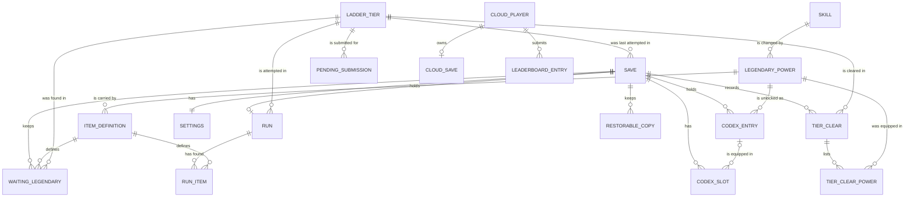

# Entity Model

The data the game keeps, from [requirements.md](requirements.md). Three kinds of entities exist:

- **Content**, read-only and shipped with each version in data files: SKILL, LEGENDARY_POWER, ITEM_DEFINITION,
  LADDER_TIER (C-024).
- **Save**, stored in IndexedDB on the device (C-016) and versioned as a whole (C-017): SAVE and everything that
  hangs off it. A save export (UC-010) contains these entities except RESTORABLE_COPY.
- **Online**, used only by the optional online features (C-004): ONLINE_IDENTITY and PENDING_SUBMISSION on the device,
  CLOUD_PLAYER, CLOUD_SAVE, and LEADERBOARD_ENTRY in the cloud backend. ONLINE_IDENTITY is never part of a save export.

The in-run simulation state (enemies, projectiles, effects) is not modeled here. It is stored as one snapshot in RUN.

## Entity Relationship Diagram

### SKILL

An action the hero performs when the player presses a skill button (content).

| Attribute    | Description                                  | Data Type | Length/Precision | Validation Rules       |
|--------------|----------------------------------------------|-----------|------------------|------------------------|
| id           | Stable key of the skill in the data files    | String    | 50               | Primary Key            |
| name         | Name shown to the player                     | String    | 50               | Not Null               |
| button_index | Skill button that triggers the skill         | Integer   | 10               | Not Null, Min: 1, Max: 4 |

### LEGENDARY_POWER

An effect of a legendary that changes how one skill behaves (content).

| Attribute   | Description                                        | Data Type | Length/Precision | Validation Rules                     |
|-------------|----------------------------------------------------|-----------|------------------|--------------------------------------|
| id          | Stable key of the legendary power in the data files | String    | 50               | Primary Key                          |
| name        | Name shown to the player                           | String    | 50               | Not Null, Unique                     |
| skill_id    | Skill whose behavior the power changes             | String    | 50               | Not Null, Foreign Key (SKILL.id)     |
| description | What the power changes in the skill, in skill terms | String    | 300              | Not Null                             |

### ITEM_DEFINITION

A kind of item that can drop in a run (content).

| Attribute          | Description                                     | Data Type | Length/Precision | Validation Rules                         |
|--------------------|-------------------------------------------------|-----------|------------------|------------------------------------------|
| id                 | Stable key of the item in the data files        | String    | 50               | Primary Key                              |
| name               | Name shown to the player                        | String    | 50               | Not Null                                 |
| gear_slot          | Gear slot the item fits                         | Integer   | 10               | Not Null, Min: 1, Max: 6                 |
| legendary_power_id | Legendary power the item carries, for a legendary | String    | 50               | Optional, Foreign Key (LEGENDARY_POWER.id) |
| is_starting_item   | The item is part of every run's starting items  | Boolean   | 1                | Not Null                                 |

#### Constraints

- An item with a legendary_power_id is a legendary; a starting item is never a legendary.

### LADDER_TIER

One step of the challenge ladder with a fixed difficulty (content).

| Attribute       | Description                                         | Data Type | Length/Precision | Validation Rules             |
|-----------------|-----------------------------------------------------|-----------|------------------|------------------------------|
| id              | Number of the tier, starting at 1                   | Integer   | 10               | Primary Key                  |
| enemy_strength  | Strength of the tier's enemies relative to tier 1   | Decimal   | 10,2             | Not Null, Min: 1, Max: 9999  |

### SAVE

All of the player's progress stored on the device; exactly one exists per device.

| Attribute           | Description                                                  | Data Type | Length/Precision | Validation Rules             |
|---------------------|--------------------------------------------------------------|-----------|------------------|------------------------------|
| id                  | Unique identifier                                            | Long      | 19               | Primary Key, Sequence        |
| format_version      | Save format version of the stored structure                 | Integer   | 10               | Not Null, Min: 1, Max: 9999  |
| game_version        | Version of the game that last stored the save               | String    | 30               | Not Null                     |
| runs_without_legendary | Played runs in a row that ended without a legendary drop, for bad-luck protection | Integer | 10 | Not Null, Min: 0, Max: 9999 |
| last_tier_id        | Tier of the last run, preselected for the next run           | Integer   | 10               | Optional, Foreign Key (LADDER_TIER.id) |
| install_hint_dismissed | The player dismissed or followed the install hint         | Boolean   | 1                | Not Null                     |
| created_at          | When the save was first created                              | DateTime  | -                | Not Null                     |
| updated_at          | When the save was last stored                                | DateTime  | -                | Not Null                     |

### CODEX_ENTRY

A codex power: a legendary power unlocked in the codex for good by sacrificing a legendary (UC-007).

| Attribute          | Description                                   | Data Type | Length/Precision | Validation Rules                           |
|--------------------|-----------------------------------------------|-----------|------------------|--------------------------------------------|
| id                 | Unique identifier                             | Long      | 19               | Primary Key, Sequence                      |
| save_id            | Save the codex belongs to                     | Long      | 19               | Not Null, Foreign Key (SAVE.id)            |
| legendary_power_id | Legendary power that is unlocked              | String    | 50               | Not Null, Foreign Key (LEGENDARY_POWER.id) |
| unlocked_at        | When the legendary was sacrificed             | DateTime  | -                | Not Null                                   |
| unlocked_in_tier   | Tier of the run in which the sacrificed legendary was found | Integer | 10               | Not Null, Min: 1, Max: 9999                |

#### Constraints

- A legendary power is unlocked at most once per save (save_id, legendary_power_id are unique together).
- A codex entry is never deleted, except when an import or a cloud restore replaces the whole save.
- A codex entry is created in the same storage transaction that deletes the sacrificed WAITING_LEGENDARY.

### WAITING_LEGENDARY

A legendary kept after its run ended because its legendary power is not in the codex yet; it waits until the player
sacrifices it (UC-007 BR-003, BR-004).

| Attribute          | Description                                        | Data Type | Length/Precision | Validation Rules                           |
|--------------------|----------------------------------------------------|-----------|------------------|--------------------------------------------|
| id                 | Unique identifier                                  | Long      | 19               | Primary Key, Sequence                      |
| save_id            | Save the waiting legendary belongs to              | Long      | 19               | Not Null, Foreign Key (SAVE.id)            |
| item_definition_id | The legendary item                                 | String    | 50               | Not Null, Foreign Key (ITEM_DEFINITION.id) |
| found_at           | When the run that found it ended                   | DateTime  | -                | Not Null                                   |
| found_in_tier      | Tier of the run in which it was found              | Integer   | 10               | Not Null, Foreign Key (LADDER_TIER.id)     |

#### Constraints

- The item definition is a legendary (ITEM_DEFINITION.legendary_power_id is set).
- At most one waiting legendary per legendary power per save, and none whose legendary power is already in the codex.
- A waiting legendary never expires; it is deleted only by a sacrifice, or when an import or a cloud restore replaces
  the whole save.

### CODEX_SLOT

One of the places that holds a codex power the hero carries into the next run.

| Attribute      | Description                               | Data Type | Length/Precision | Validation Rules                       |
|----------------|-------------------------------------------|-----------|------------------|----------------------------------------|
| id             | Unique identifier                         | Long      | 19               | Primary Key, Sequence                  |
| save_id        | Save the codex slot belongs to            | Long      | 19               | Not Null, Foreign Key (SAVE.id)        |
| slot_index     | Position of the codex slot                | Integer   | 10               | Not Null, Min: 1, Max: 6               |
| codex_entry_id | Codex power equipped in the slot, if any  | Long      | 19               | Optional, Foreign Key (CODEX_ENTRY.id) |

#### Constraints

- Each slot position exists once per save (save_id, slot_index are unique together).
- A codex power is equipped in at most one codex slot of a save (save_id, codex_entry_id are unique together when codex_entry_id is set).
- The number of codex slots equals the number set in tuning data.

### TIER_CLEAR

The record that the player defeated the guardian of a tier, with the best play time.

| Attribute           | Description                                       | Data Type | Length/Precision | Validation Rules                      |
|---------------------|---------------------------------------------------|-----------|------------------|---------------------------------------|
| id                  | Unique identifier                                 | Long      | 19               | Primary Key, Sequence                 |
| save_id             | Save the tier clear belongs to                    | Long      | 19               | Not Null, Foreign Key (SAVE.id)       |
| tier_id             | Tier that was cleared                             | Integer   | 10               | Not Null, Foreign Key (LADDER_TIER.id) |
| best_play_time_ms   | Shortest play time of a clear, pauses excluded    | Long      | 19               | Not Null, Min: 1, Max: 86400000       |
| first_cleared_at    | When the tier was first cleared                   | DateTime  | -                | Not Null                              |
| best_cleared_at     | When the best play time was reached               | DateTime  | -                | Not Null                              |

#### Constraints

- A tier is recorded at most once per save (save_id, tier_id are unique together).
- A tier above 1 has a tier clear only when the tier below it has one.

### TIER_CLEAR_POWER

A codex power that was equipped in the run of a tier's best play time.

| Attribute          | Description                          | Data Type | Length/Precision | Validation Rules                           |
|--------------------|--------------------------------------|-----------|------------------|--------------------------------------------|
| id                 | Unique identifier                    | Long      | 19               | Primary Key, Sequence                      |
| tier_clear_id      | Tier clear the power belongs to      | Long      | 19               | Not Null, Foreign Key (TIER_CLEAR.id)      |
| legendary_power_id | Legendary power that was equipped    | String    | 50               | Not Null, Foreign Key (LEGENDARY_POWER.id) |

### SETTINGS

The player's settings, stored with the save.

| Attribute         | Description                                      | Data Type | Length/Precision | Validation Rules                   |
|-------------------|--------------------------------------------------|-----------|------------------|------------------------------------|
| id                | Unique identifier                                | Long      | 19               | Primary Key, Sequence              |
| save_id           | Save the settings belong to                      | Long      | 19               | Not Null, Unique, Foreign Key (SAVE.id) |
| frame_cap         | Highest number of frames per second rendered     | Integer   | 10               | Not Null, Values: 30, 60           |
| sound_volume      | Volume of sound effects in percent               | Integer   | 10               | Not Null, Min: 0, Max: 100         |
| music_volume      | Volume of music in percent                       | Integer   | 10               | Not Null, Min: 0, Max: 100         |
| reminder_minutes  | Play time after which the play reminder shows; empty when the reminder is off | Integer | 10 | Optional, Min: 15, Max: 120 |

#### Constraints

- reminder_minutes is a multiple of 15.

### RUN

The stored state of the one run in progress or paused, used to resume it.

| Attribute         | Description                                                    | Data Type | Length/Precision | Validation Rules                       |
|-------------------|----------------------------------------------------------------|-----------|------------------|----------------------------------------|
| id                | Unique identifier                                              | Long      | 19               | Primary Key, Sequence                  |
| save_id           | Save the run belongs to                                        | Long      | 19               | Not Null, Unique, Foreign Key (SAVE.id) |
| tier_id           | Tier the run attempts                                          | Integer   | 10               | Not Null, Foreign Key (LADDER_TIER.id) |
| seed              | Seed of the run                                                | Long      | 19               | Not Null                               |
| game_version      | Version of the game that started the run                       | String    | 30               | Not Null                               |
| spans_versions    | The run was resumed on a newer game version than started it    | Boolean   | 1                | Not Null                               |
| state             | Whether the run was last stored while running or paused        | String    | 10               | Not Null, Values: Running, Paused      |
| simulation_step   | Simulation step of the stored state                            | Long      | 19               | Not Null, Min: 0, Max: 100000000       |
| play_time_ms      | Play time of the run so far, pauses excluded                   | Long      | 19               | Not Null, Min: 0, Max: 86400000        |
| codex_powers      | Binary content: the legendary power ids equipped at run start  | String    | -                | Not Null                               |
| snapshot          | Binary content: the simulation state at simulation_step        | String    | -                | Not Null                               |
| input_log         | Binary content: the input log from step 0 to simulation_step   | String    | -                | Not Null                               |
| legendary_dropped | A legendary dropped in the run so far                          | Boolean   | 1                | Not Null                               |
| stored_at         | When the state was last stored                                 | DateTime  | -                | Not Null                               |

### RUN_ITEM

An item found or equipped in the stored run.

| Attribute          | Description                                   | Data Type | Length/Precision | Validation Rules                           |
|--------------------|-----------------------------------------------|-----------|------------------|--------------------------------------------|
| id                 | Unique identifier                             | Long      | 19               | Primary Key, Sequence                      |
| run_id             | Run the item belongs to                       | Long      | 19               | Not Null, Foreign Key (RUN.id)             |
| item_definition_id | Kind of item                                  | String    | 50               | Not Null, Foreign Key (ITEM_DEFINITION.id) |
| equipped           | The item is equipped in its gear slot         | Boolean   | 1                | Not Null                                   |
| found_at_step      | Simulation step at which the hero collected it | Long     | 19               | Not Null, Min: 0, Max: 100000000           |

#### Constraints

- At most one equipped item per gear slot of a run.

### RESTORABLE_COPY

The save that the last import, cloud restore, or failed migration replaced, kept so the player can go back.

| Attribute      | Description                                         | Data Type | Length/Precision | Validation Rules                              |
|----------------|-----------------------------------------------------|-----------|------------------|-----------------------------------------------|
| id             | Unique identifier                                   | Long      | 19               | Primary Key, Sequence                         |
| save_id        | Save that replaced the copy                         | Long      | 19               | Not Null, Foreign Key (SAVE.id)               |
| reason         | What replaced the copy                              | String    | 20               | Not Null, Values: Import, CloudRestore, Migration |
| format_version | Save format version of the copy                     | Integer   | 10               | Not Null, Min: 1, Max: 9999                   |
| content        | Binary content: the replaced save as a save export  | String    | -                | Not Null                                      |
| created_at     | When the copy was kept                              | DateTime  | -                | Not Null                                      |

#### Constraints

- A save keeps at most the 3 most recent restorable copies; storing a fourth deletes the oldest.

### ONLINE_IDENTITY

The random identity under which this device uses the online features; never part of a save export.

| Attribute     | Description                                       | Data Type | Length/Precision | Validation Rules |
|---------------|---------------------------------------------------|-----------|------------------|------------------|
| id            | Unique identifier                                 | Long      | 19               | Primary Key, Sequence |
| player_key    | Random key that identifies the player to the cloud backend | String | 64   | Not Null, Unique |
| display_name  | Name shown on the leaderboard                     | String    | 16               | Not Null         |
| enabled_at    | When the player enabled the online features       | DateTime  | -                | Not Null         |
| last_backup_at | When the last cloud save was stored              | DateTime  | -                | Optional         |

### PENDING_SUBMISSION

A ladder result waiting on the device to be sent to the leaderboard.

| Attribute      | Description                                   | Data Type | Length/Precision | Validation Rules                        |
|----------------|-----------------------------------------------|-----------|------------------|-----------------------------------------|
| id             | Unique identifier                             | Long      | 19               | Primary Key, Sequence                   |
| tier_id        | Tier that was cleared                         | Integer   | 10               | Not Null, Foreign Key (LADDER_TIER.id)  |
| play_time_ms   | Play time of the clear                        | Long      | 19               | Not Null, Min: 1, Max: 86400000         |
| seed           | Seed of the run                               | Long      | 19               | Not Null                                |
| game_version   | Version of the game that played the run       | String    | 30               | Not Null                                |
| input_log      | Binary content: the input log of the run      | String    | -                | Not Null                                |
| status         | State of the submission                       | String    | 10               | Not Null, Values: Pending, Submitted, Refused |
| refusal_reason | Reason the cloud backend gave for a refusal   | String    | 200              | Optional                                |

### CLOUD_PLAYER

A player registered with the cloud backend, without personal data (C-020).

| Attribute    | Description                                | Data Type | Length/Precision | Validation Rules |
|--------------|--------------------------------------------|-----------|------------------|------------------|
| id           | Unique identifier                          | Long      | 19               | Primary Key, Sequence |
| player_key   | Hash of the random key the device registered with; the key itself is never stored (ADR-013) | String    | 64               | Not Null, Unique |
| display_name | Name shown on the leaderboard              | String    | 16               | Not Null         |
| created_at   | When the player registered                 | DateTime  | -                | Not Null         |

### CLOUD_SAVE

The backup of a player's save in the cloud backend.

| Attribute       | Description                                  | Data Type | Length/Precision | Validation Rules                             |
|-----------------|----------------------------------------------|-----------|------------------|----------------------------------------------|
| id              | Unique identifier                            | Long      | 19               | Primary Key, Sequence                        |
| cloud_player_id | Player the cloud save belongs to             | Long      | 19               | Not Null, Unique, Foreign Key (CLOUD_PLAYER.id) |
| format_version  | Save format version of the copy              | Integer   | 10               | Not Null, Min: 1, Max: 9999                  |
| content         | Binary content: the save as a save export    | String    | -                | Not Null                                     |
| stored_at       | When the copy was stored                     | DateTime  | -                | Not Null                                     |

### LEADERBOARD_ENTRY

A player's best submitted result for one tier.

| Attribute       | Description                                    | Data Type | Length/Precision | Validation Rules                        |
|-----------------|------------------------------------------------|-----------|------------------|-----------------------------------------|
| id              | Unique identifier                              | Long      | 19               | Primary Key, Sequence                   |
| cloud_player_id | Player who submitted the result                | Long      | 19               | Not Null, Foreign Key (CLOUD_PLAYER.id) |
| tier            | Number of the cleared tier                     | Integer   | 10               | Not Null, Min: 1, Max: 9999             |
| play_time_ms    | Play time of the clear                         | Long      | 19               | Not Null, Min: 1, Max: 86400000         |
| seed            | Seed of the run                                | Long      | 19               | Not Null                                |
| game_version    | Version of the game that played the run        | String    | 30               | Not Null                                |
| input_log       | Binary content: the input log for verification | String    | -                | Not Null                                |
| verified        | A replay confirmed the result                  | Boolean   | 1                | Not Null                                |
| submitted_at    | When the result was submitted                  | DateTime  | -                | Not Null                                |

#### Constraints

- A player has at most one entry per tier (cloud_player_id, tier are unique together).
